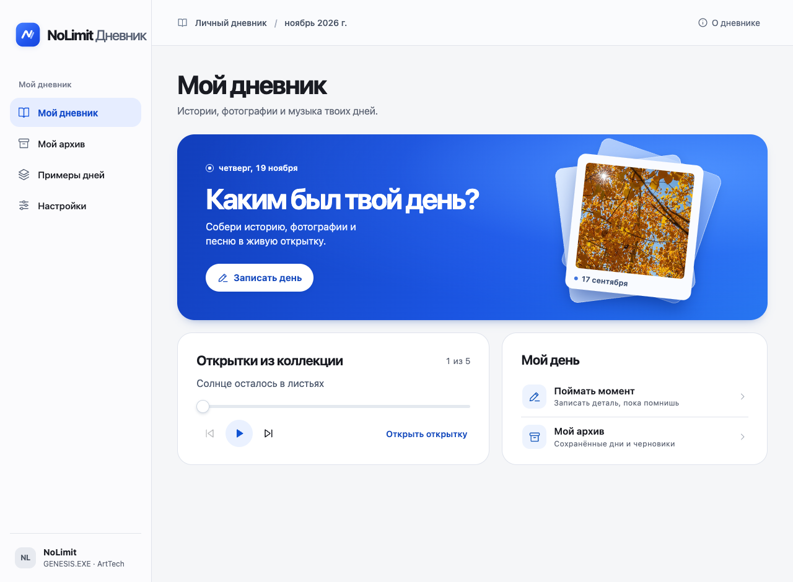
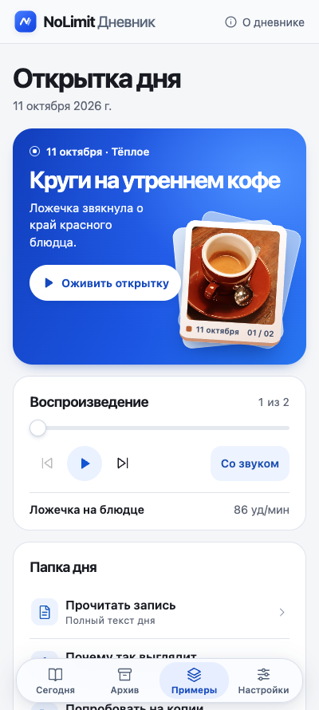

<p align="center"></p>

<h1 align="center">NoLimit · Дневник</h1>

<p align="center"><strong>GENESIS.EXE · ArtTech · Make the Invisible Visible</strong></p>

<p align="center">
  <a href="https://nolimit-audit-atelier.beige-clove-1590.chatgpt.site/#day/demo-coffee"><strong>▶ Оживить первую открытку</strong></a> ·
  <a href="https://nolimit-audit-atelier.beige-clove-1590.chatgpt.site/#today">✍️ Записать свой день</a> ·
  <a href="https://nolimit-audit-atelier.beige-clove-1590.chatgpt.site/#examples">🖼️ Все примеры</a>
</p>

Чашка эспрессо, размытый циферблат и звон ложечки о блюдце. Из этих деталей в NoLimit получается открытка «Круги на утреннем кофе». В ней можно включить мелодию, перелистнуть снимок и прочитать, почему автору запомнилось именно это утро.

**NoLimit** — браузерный дневник для людей, которые снимают на телефон и помнят дни по песням. Днём можно записать одну фразу, вечером добавить фотографии и музыку. Слова задают настроение открытки, обложка даёт цвет полей, трек — длительность кадра. Личные записи сохраняются в браузере.

<p align="center">
  <a href="https://nolimit-audit-atelier.beige-clove-1590.chatgpt.site/#today"></a>
  <a href="https://nolimit-audit-atelier.beige-clove-1590.chatgpt.site/#day/demo-coffee"></a>
</p>

Переключатель **РУ · ҚАЗ · EN** в верхней панели меняет язык интерфейса и пяти примеров. Он запоминает выбор в этом браузере. Личная запись, названия файлов и место в открытке сохраняются. [Сверка с требованиями ArtTech](docs/ARTTECH-CHECK.md)

## 🎬 Проверка за три минуты

Для этого маршрута уже есть фотографии, текст и звук. Понадобится только браузер.

1. **Посмотрите оригинал.** Нажмите «Оживить открытку» в примере про кофе. Переключитесь с чашки на циферблат. Закройте просмотр и прочитайте, что в тот день записал автор. [☕ Открыть пример](https://nolimit-audit-atelier.beige-clove-1590.chatgpt.site/#day/demo-coffee)
2. **Измените одну деталь.** В «Папке дня» выберите «Попробовать на копии». В редакторе нажмите на второй снимок, затем «На обложку». В предпросмотре вместо чашки появятся часы. Оттенок полей сменится с тёплого `#B55F32` на серый `#939393`. Текст и песня у обеих версий те же.
3. **Сохраните свою версию.** Нажмите «Сохранить открытку». В разделе «Мои дни» введите **ложечка**. Дневник найдёт запись по слову из истории. Обновите страницу и откройте сохранённый день с новой обложкой. [Мои дни](https://nolimit-audit-atelier.beige-clove-1590.chatgpt.site/#archive)
4. **Проверьте перенос.** В настройках нажмите «Скачать копию». В другом браузере откройте тот же сайт и выберите «Восстановить из файла». Перед добавлением дневник покажет число записей, совпадений и конфликтующих версий. [⚙️ Настройки и копии](https://nolimit-audit-atelier.beige-clove-1590.chatgpt.site/#settings)

## 🎨 Как устроена живая открытка

Задачу трека *Make the Invisible Visible* команда трактует через воспоминания. Ощущение от дня можно передать тем, как долго задерживается снимок, как движется отпечаток и какая фраза остаётся под ним. Решения принимает набор локальных правил. Каждое из них можно увидеть в самой открытке.

| Материал | Что делает дневник | Что выбирает автор записи |
| --- | --- | --- |
| ✍️ **Текст** | Берёт слова для названия и фразу для подписи. По словам вроде «улыбка», «тревожно» или «грустно» подбирает настроение, цвет фона, наклон и движение отпечатка. | Можно выбрать другую фразу, вписать название или задать настроение вручную. Полный рассказ сохраняется рядом с открыткой. |
| 📷 **Фотографии** | Для загруженного снимка уменьшает изображение до 36 × 36 пикселей, группирует близкие цвета и выбирает оттенок для полей. Палитру определяет первая фотография. | Можно назначить обложку, поменять снимки местами и сдвинуть точку кадрирования по двум осям. |
| 🎵 **Музыка** | Для поддерживаемого аудиофайла оценивает энергию и, если различим пульс, темп. Длительность кадра рассчитывает в долях. Для ссылки на YouTube или трек Spotify получает время воспроизведения от официального плеера. | Можно загрузить свой трек, дать ссылку на музыкальный сервис или изменить ритм кадров в настройках оформления. |

У спокойной открытки бежевый фон и медленное движение кадра. У грустной фон синий, а отпечаток слегка приподнимается. На жёлтой радостной открытке снимок сдвигается в сторону. Оранжевая напряжённая и красная злая открытки используют ритмический монтаж с разным наклоном отпечатка. [Описание художественных решений](docs/ARTTECH.md) · [Правила сборки](dist/diary/art.js)

## 🖼️ Пять дней, которые можно открыть

В каждом примере есть полный текст, фотографии с указанием источников и мелодия NoLimit. Для сравнения откройте осеннюю прогулку и старт ракеты. В первой открытке кадру отведено **7,5 секунды**, во второй — **около 2,6 секунды**.

| Открытка | Что в кадре | Мелодия NoLimit | Темп |
| --- | --- | --- | ---: |
| [🍂 Солнце осталось в листьях](https://nolimit-audit-atelier.beige-clove-1590.chatgpt.site/#day/demo-leaves) | Три снимка прогулки — золотые осины, река Ламар и клён | «Послевкусие» | 64 уд/мин |
| [🚀 Щелчок затвора перед стартом](https://nolimit-audit-atelier.beige-clove-1590.chatgpt.site/#day/demo-launch) | Один кадр с Falcon 9 на стартовой площадке | «Обратный отсчёт» | 136 уд/мин |
| [☕ Круги на утреннем кофе](https://nolimit-audit-atelier.beige-clove-1590.chatgpt.site/#day/demo-coffee) | Чашка на красном блюдце и циферблат | «Ложечка на блюдце» | 86 уд/мин |
| [🐈 Усы на краю одеяла](https://nolimit-audit-atelier.beige-clove-1590.chatgpt.site/#day/demo-cat) | Кошка выглядывает из-под одеяла | «Тёплая лапа» | 74 уд/мин |
| [🌙 Луна над крышами домов](https://nolimit-audit-atelier.beige-clove-1590.chatgpt.site/#day/demo-moon) | Красная луна над тёмными зданиями | «Ночное окно» | 54 уд/мин |

## 📔 Как собрать свой день

- **Днём** нажмите «Добавить заметку», запишите короткую деталь и нажмите «Сохранить заметку». Если открытка за сегодня уже готова, текст сразу появится в ней. В «Моём дне» корзина рядом с заметкой удаляет только её, а корзина рядом с названием дня — всю запись после подтверждения. Для отмены нажмите «Вернуть». [Мой дневник](https://nolimit-audit-atelier.beige-clove-1590.chatgpt.site/#today)
- **В редакторе** добавьте текст, от одной до шести фотографий и песню. Подойдут JPEG, PNG и WebP до 12 МБ каждый. Для HEIC/HEIF требуется поддержка декодирования в браузере. Для музыки подойдут MP3, AAC, M4A или WAV до 25 МБ либо HTTPS-ссылка, например на Spotify, Apple Music или YouTube.
- **При просмотре** нажмите «Оживить открытку». Открывается крупное фото и запускается свой аудиофайл или встроенный плеер YouTube либо Spotify. Другие музыкальные сервисы открываются по ссылке. Внутри просмотра можно листать кадры. При закрытии музыка останавливается. В «Прочитать запись» доступна озвучка, если на устройстве есть локальный голос для языка записи.
- **Спустя время** найдите день по дате, названию, фрагменту текста или имени трека. Архив поддерживает фильтр по месяцу. У одной даты могут быть несколько версий, одну из которых можно назначить основной.

## 🔐 Где хранятся воспоминания

**Записи, фото, музыка и черновики хранятся в IndexedDB** этого браузера для адреса дневника. Регистрация для работы не требуется. Расчёт палитры, анализ аудио и поиск выполняются на устройстве. После первого успешного кэширования оболочка и демопримеры открываются без сети. Встроенным плеерам и внешним ссылкам нужен интернет. Доступность записи и полной версии трека определяет музыкальный сервис.

Для переноса на новый телефон скачайте ZIP в настройках. В копию входят сохранённые дни, черновики, быстрые заметки, версии и медиа. При повторном импорте дневник пропускает совпадения, при конфликте сохраняет отдельную версию. Из меню папки можно экспортировать один день. Перед очисткой данных браузера стоит сохранить ZIP — с ним можно восстановить архив вместе с фотографиями и звуком. [Управление данными и режим «Уменьшить движение»](https://nolimit-audit-atelier.beige-clove-1590.chatgpt.site/#settings)

## 🔎 Где посмотреть реализацию

Приложение состоит из HTML, CSS и модулей JavaScript. Каталог `dist/` можно сразу раздавать статическим сервером. Для работы самого дневника достаточно современного браузера и HTTPS или localhost.

| Задача | Реализация |
| --- | --- |
| Навигация, быстрые заметки, создание личной копии | [app.js](dist/diary/app.js) · [home.js](dist/diary/home.js) |
| Редактор, автосохранение, анализ фотографии через Canvas 2D и музыки через Web Audio | [editor.js](dist/diary/editor.js) |
| Расчёт названия, палитры, движения и длительности кадра | [art.js](dist/diary/art.js) |
| Просмотр фотографий, музыка, жесты и озвучка | [player.js](dist/diary/player.js) · [интеграция музыкальных сервисов](dist/diary/provider-player.js) |
| Поиск, версии, локальная база, экспорт и восстановление | [library.js](dist/diary/library.js) · [store.js](dist/diary/store.js) · [settings.js](dist/diary/settings.js) |
| Кэширование приложения и отдача фрагментов MP3 без сети | [Service Worker](dist/diary-sw.js) · [список ресурсов](dist/offline-list.js) |

### 💻 Локальный запуск

Из терминала с установленными Git и Python 3 выполните команды ниже, затем откройте [локальный дневник](http://127.0.0.1:8000/).

```sh
git clone https://github.com/FoXs1953/nolimit-audit.git
cd nolimit-audit
python3 -m http.server 8000 --bind 127.0.0.1 --directory dist
```

### 🧪 Что проверяют автотесты

| Проверка | Что воспроизводит |
| --- | --- |
| [Пользовательский сценарий](tools/check_diary.cjs) | Быстрая заметка, перезагрузка, свои фото и WAV, сохранение, поиск, копирование примера, удаление и восстановление. Проверки интерфейса на ширинах 320, 390, 820 и 1360 px. |
| [Три языка](tools/check_diary_languages.cjs) | Переключение с телефона, сохранность текста, выбранного кадра и версии в двух вкладках. |
| [Влияние материалов](tools/check_diary_inputs.cjs) | Изменение цвета обложки, движения и длительности кадра по реальным изображениям и аудиофайлам. |
| [Демонстрационные дни](tools/check_diary_art.cjs) | Пять историй на трёх языках, сгенерированные названия, музыка, воспроизведение и озвучка. |
| [Хранение и перенос](tools/check_diary_storage.cjs) | Одновременные правки, сохранность медиа и черновиков, повторный импорт, конфликты и отказ от повреждённого ZIP. |
| [Работа без сети](tools/check_diary_offline.cjs) | Перезагрузка после отключения сети, переход к демо, загрузка фото и запрос фрагмента аудио из кэша. |

<details>
<summary><strong>Воспроизвести проверки в Chromium и WebKit</strong></summary>

Оставьте локальный сервер запущенным. Во втором терминале из корня репозитория выполните команды с Node.js 22 и npm. Проверки используют временные профили браузеров.

```sh
npm ci
npx playwright install chromium webkit
for engine in chromium webkit; do
  ENGINE="$engine" node tools/check_diary.cjs http://127.0.0.1:8000/ || exit 1
  ENGINE="$engine" node tools/check_diary_languages.cjs http://127.0.0.1:8000/ || exit 1
  ENGINE="$engine" node tools/check_diary_inputs.cjs http://127.0.0.1:8000/ || exit 1
  ENGINE="$engine" node tools/check_diary_art.cjs http://127.0.0.1:8000/ || exit 1
  ENGINE="$engine" node tools/check_music_links.cjs http://127.0.0.1:8000/ || exit 1
  ENGINE="$engine" node tools/check_diary_storage.cjs http://127.0.0.1:8000/ || exit 1
  ENGINE="$engine" node tools/check_diary_offline.cjs http://127.0.0.1:8000/ || exit 1
done
```

После изменения файлов приложения обновите список для офлайн-кэша командой `python3 tools/update_offline.py`. GitHub Actions сверяет этот список и запускает три сценария в обоих движках. [Конфигурация CI](.github/workflows/diary.yml) · [История запусков](https://github.com/FoXs1953/nolimit-audit/actions/workflows/diary.yml)

</details>

## 🫶 Команда и материалы

**Команда NoLimit** разработала интерфейс дневника, редактор, систему художественных правил и проигрыватель. Пять мелодий написаны для проекта. При создании прототипа использовался Codex. [Описание проекта для трека ArtTech](docs/ARTTECH.md) · [Задание GENESIS.EXE](https://genesis-exe.com/cabinet.html#hackathon)

Демонстрационные истории вымышлены. Среди авторов снимков — Diane Renkin / National Park Service, SpaceX, Rachel Michetti / Pikolo Espresso Bar, Stefan van der Walt и NASA / Ben Smegelsky. В каждой публичной открытке кнопка «Авторы материалов» ведёт к источникам её фотографий. Условия использования снимков указаны отдельно от лицензии кода. [Каталог с указанием авторства](dist/diary/demos.js)

Авторский код проекта распространяется по MIT. Для упаковки ZIP в поставку включена fflate 0.8.2. [Лицензия проекта](LICENSE) · [Лицензия fflate](dist/diary/vendor/fflate-LICENSE.txt)
